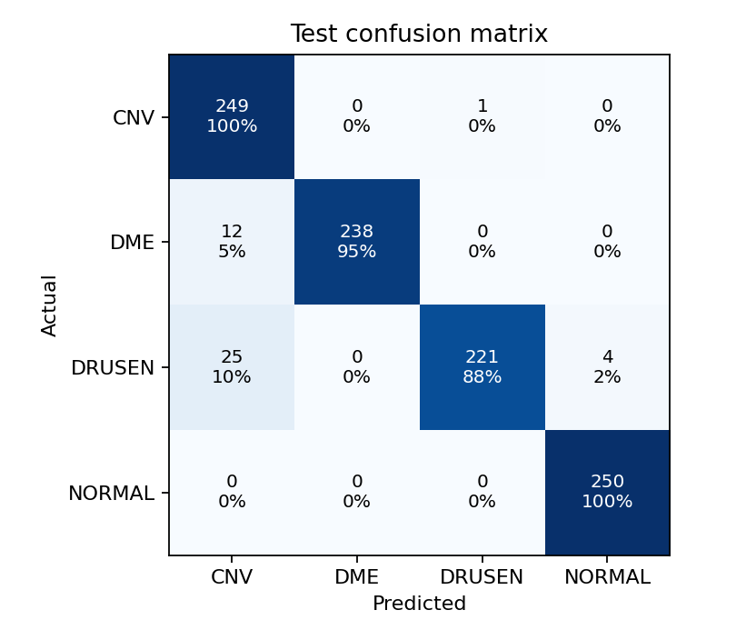
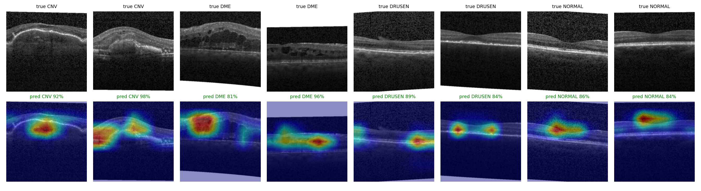

# OCT Retinal Classifier

Classifies retinal OCT scans into four groups: CNV, DME, DRUSEN and NORMAL.

This started as a single Colab notebook I wrote in 2025 (still in `legacy/`). I rebuilt it as a
small python package, fixed the problems I found in the old version, and tried a hybrid model
(a CNN plus a conv-attention model, averaged together).

This is a learning project. It is not a medical device and should not be used to diagnose anything.

## Results

Test set: 1000 images, 250 per class. All numbers are from one training run (seed 42).

| model | accuracy | macro F1 | macro AUC |
|---|---|---|---|
| ConvNeXt-Tiny (CNN) | 95.5% | 0.955 | 0.9965 |
| MaxViT-Tiny (conv + attention) | 95.1% | 0.951 | 0.9971 |
| both averaged (hybrid) | 95.8% | 0.958 | 0.9974 |

The averaged model is a little better, but with 1000 test images the 95% interval on any of
these accuracies is about plus or minus 1.2 points. So I would not claim the hybrid is truly
better than the single models, only that it is not worse.

Per class, for the averaged model:

| class | precision | recall |
|---|---|---|
| CNV | 0.871 | 0.996 |
| DME | 1.000 | 0.952 |
| DRUSEN | 0.995 | 0.884 |
| NORMAL | 0.984 | 1.000 |



Almost all the mistakes go one way: DRUSEN scans (25 of 250) and DME scans (12 of 250) get
called CNV. Normal scans were never missed as a disease in this test set, but 4 DRUSEN scans
were called normal.

### What the model looks at

Grad-CAM heatmaps from the averaged model. Top row is the scan, bottom row is where the model
looked. The examples are random picks (2 per class), not hand picked, and they happen to all
be correct. The wrong ones are in the confusion matrix above.



## Data

I used OCTMNIST from MedMNIST at 224x224. It is the Kermany OCT2017 data (the same source the
old notebook used), repackaged with a fixed split:

| split | images |
|---|---|
| train | 97,477 (CNV 33,484 / DME 10,213 / DRUSEN 7,754 / NORMAL 46,026) |
| val | 10,832 |
| test | 1,000 (250 each) |

My original dataset zip was no longer in my Drive when I reran this, so the numbers above are
on the MedMNIST split and are not comparable with the old notebook's numbers.

Because the test set is balanced and the real data is not (almost half the training images are
normal), precision on real patients would look different from the table above.

## What was wrong with the old notebook

- It removed every NORMAL image from train, val and test, so the model could not say "healthy"
  at all. A healthy scan would always be forced into a disease class. This version uses all
  four classes.
- The test set was 300 random images that changed on every run. Now it is the full fixed test split.
- The cells were run out of order and one of them would crash if run top to bottom.
- No seed, no saved weights, no best checkpoint.
- Hue jitter on grayscale scans, wrong normalisation for the pretrained weights, and an old
  Grad-CAM hook that gives a warning.

## How it works

- `octclf/data.py` loads the folders, with a class-balanced sampler so the small classes are seen as often as the big ones.
- `octclf/model.py` builds ConvNeXt-Tiny or MaxViT-Tiny (or ResNet / EfficientNetV2) from ImageNet weights.
- `octclf/losses.py` focal loss (gamma 2) with a little label smoothing.
- `octclf/train.py` AdamW, one-cycle learning rate, mixed precision, keeps the checkpoint with the best validation macro F1.
- `octclf/evaluate.py` metrics, confusion matrix, Grad-CAM grid. Give it several checkpoints and it averages their probabilities.
- `octclf/predict.py` one image in, label plus heatmap out.

Training setup for the numbers above: 6 epochs, 16,000 images per epoch, batch 64 (48 for MaxViT),
on a free Colab T4. About 16 minutes for ConvNeXt and 26 for MaxViT.

## Run it

```
pip install -r requirements.txt
python scripts/prepare_octmnist.py --out data/octmnist     # about 4 GB download

python -m octclf.train --data data/octmnist --out runs/convnext_tiny --backbone convnext_tiny \
    --epochs 6 --samples-per-epoch 16000
python -m octclf.train --data data/octmnist --out runs/maxvit_t --backbone maxvit_t \
    --epochs 6 --batch-size 48 --lr 2e-4 --samples-per-epoch 16000

python -m octclf.evaluate --data data/octmnist \
    --ckpt runs/convnext_tiny/best.pt runs/maxvit_t/best.pt --out runs/ensemble

python -m octclf.predict --ckpt runs/convnext_tiny/best.pt --image some_scan.png
```

You need a GPU for training to be comfortable. Tests run on CPU and need no download:

```
pip install -r requirements-dev.txt
pytest
```

The trained weights are about 110 to 120 MB each and are not in this repo.
The metrics from my run are in `results/`.


## Credits

- Kermany et al., OCT2017 dataset.
- MedMNIST (Yang et al.) for the packaged OCTMNIST version.
- PyTorch / torchvision for the model weights.
